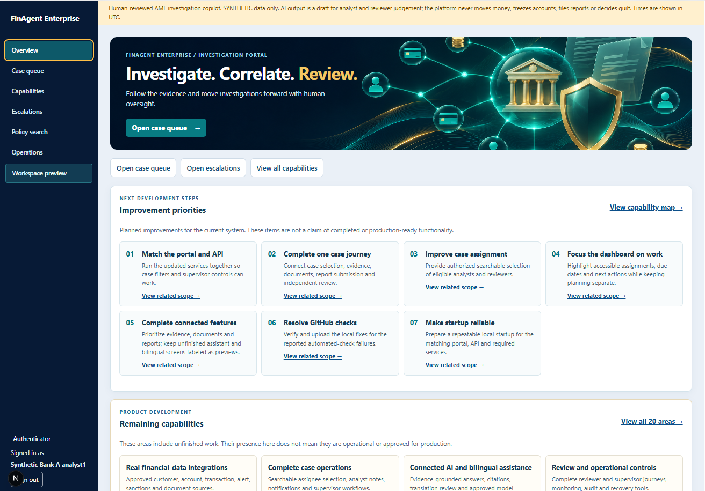
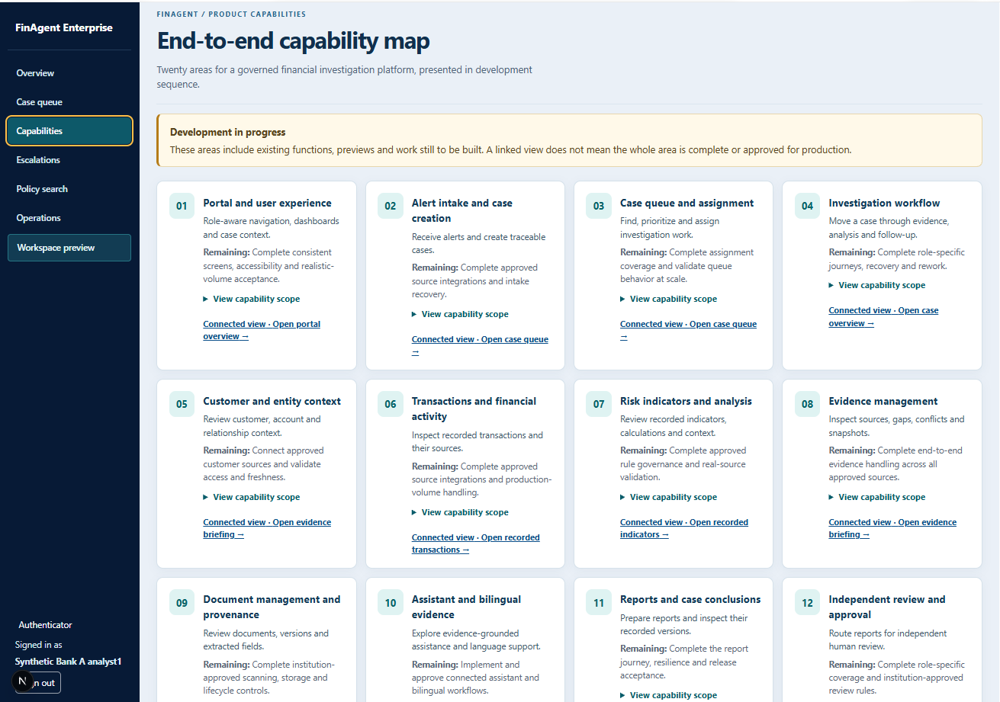
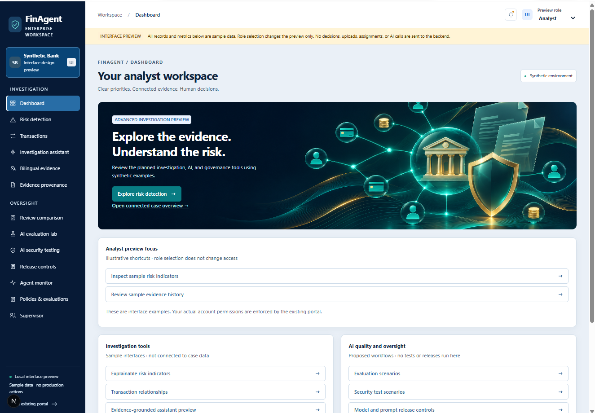
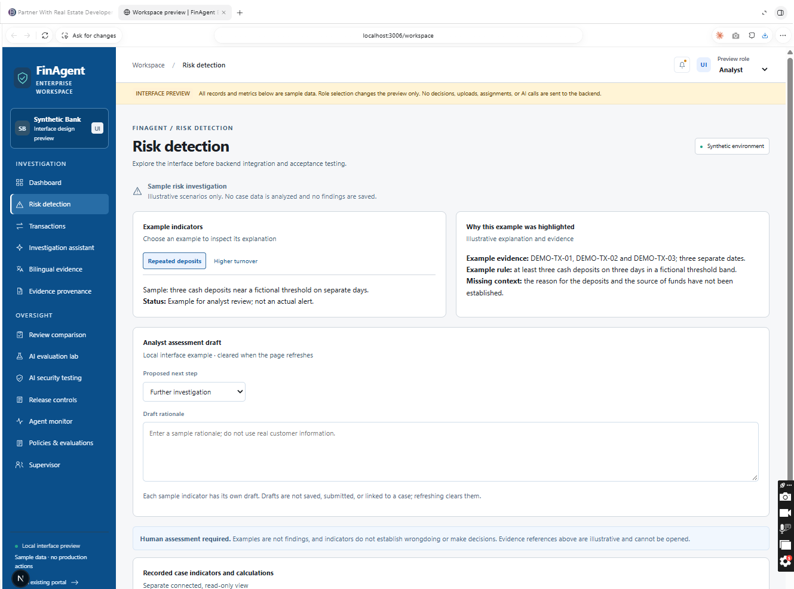
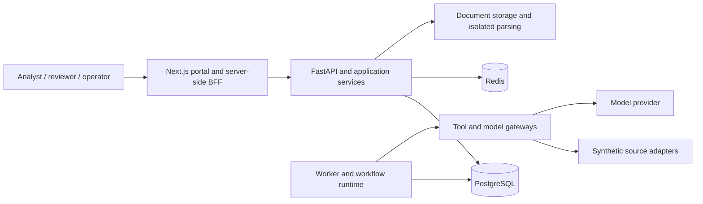

# FinAgent Enterprise

**Human-reviewed AML investigations · Evidence provenance · Governed AI · Enterprise architecture**

### FinAgent interface

**Portal overview** — the synthetic analyst dashboard and current development priorities.



**Capability map** — a structured view of the planned end-to-end product scope.



**Analyst workspace preview** — illustrative investigation and oversight interfaces.



*Local development screenshots captured on 26 November 2026 using synthetic data. Some screens reflect local work not yet included in this branch. Capability and improvement cards describe planned work; workspace previews do not perform production actions.*


*Investigation portal artwork. The illustration is not a screenshot or a depiction of live banking data.*

**Featured case study:** [Architecting evidence-linked AI investigations with independent human review](docs/07-case-study/08-CASE-STUDY.md) — architecture decisions, governed AI, security, recovery, current engineering evidence and the cloud delivery roadmap.

FinAgent is an enterprise AI engineering portfolio project exploring how analysts can investigate financial-crime alerts with evidence-linked workflows, controlled AI assistance, and independent human review.

| | |
|---|---|
| **Domain** | Anti-money laundering (AML) investigation and case review |
| **Demonstration** | Synthetic data, identities, integrations, and evaluation scenarios |
| **Status** | Active development; production readiness and institutional approval are not established |
| **Accountability** | Analysts and reviewers make decisions; AI output is a draft |
| **Current development** | The default branch contains the merged workspace; ongoing updates are reviewed on an integration branch |

> This is not a deployed bank product, a regulatory certification, or an autonomous system for deciding guilt. Local evidence and passing tests apply to the tested version and environment. Live-provider verification, independent assessment, and production acceptance remain open.

**Start here:** [Synthetic investigation walkthrough](docs/workspace-demo-walkthrough.md) · [Architecture-to-code map](docs/02-system-architecture/06-ARCHITECTURE-TO-CODE-MAP.md) · [Synthetic acceptance record](docs/05-testing-evidence/14-SYNTHETIC-ACCEPTANCE-RECORD.md) · [Latest verified branch CI · `a6c157b`](https://github.com/shah-hussain-bangash/finagent-enterprise/actions/runs/45394113664) · [Verified main-branch CI · `6c0bb87`](https://github.com/shah-hussain-bangash/finagent-enterprise/actions/runs/44917079385)

## Business problem

An investigation can require analysts to reconcile an alert with customer information, transactions, document versions, policy and prior decisions. Missing information, stale records, inconsistent sources, and unclear AI claims can make review slower and harder to explain. A useful system must help the analyst find and assess evidence while preserving access boundaries, source context and human accountability.

FinAgent addresses this problem through a synthetic investigation workflow: a case is assigned, authorized evidence is gathered, records and limitations are reviewed, investigation outputs support a draft report, and a separate reviewer assesses the submission.

## Capabilities and status

| Capability | Portfolio demonstration | Important limitation |
|---|---|---|
| Case investigation | Queues, case detail, evidence, transactions and connected workspace views | Complete role-based UI acceptance and high-volume validation are pending |
| Documents and provenance | Versions, extraction, corrections, quarantine state and evidence snapshots | Extracted data requires human verification; live scanning is unverified |
| AI-assisted analysis | Governed capabilities, source references, model gateway and deterministic validation | Output is not proof of truth; the experimental assistant candidate remains disabled |
| Reports and independent review | Versioned drafts, submission, review and recorded decisions | Actual approval authority and reviewer policy require institutional approval |
| Oversight and operations | Workflow, audit, evaluation, monitoring and recovery concepts | Target-environment operations, recovery objectives and on-call arrangements are unverified |
| Enterprise integration | Mock sources and provider adapters; reference deployment templates | Live banking, cloud, identity and model-provider integrations are not verified |

Some workspace screens contain illustrative or unavailable features. Labels in the application and the [workspace preview documentation](docs/workspace-interface-preview.md) identify the intended scope.

### Workspace preview



*Synthetic workspace preview captured on 26 November 2026. The risk-detection example is illustrative: its assessment is not saved, submitted or linked to a case. Connected case views are identified separately in the application.*

## Architecture overview



This diagram is a **logical architecture**, not a verified production deployment. See the [enterprise architecture](docs/02-system-architecture/03-ENTERPRISE-SOLUTION-ARCHITECTURE.md) for boundaries and trade-offs, [ADRs](docs/adr/) for decisions, and the [source register](docs/data/source-register.md) for integration assumptions.

### Technology

| Area | Repository implementation or reference |
|---|---|
| Web | Next.js, React and TypeScript; server-side backend-for-frontend |
| API and domain | Python, FastAPI, application services and typed models |
| Workflow | LangGraph-based orchestration and worker processing |
| Persistence | PostgreSQL, Redis, migrations and tenant-aware data models |
| Documents and AI | Document intake and parsing, gateway-based model access, deterministic checks and evidence references |
| Delivery | Docker Compose for local work; GitHub Actions, Helm and Terraform as repository assets |

The presence of an adapter or infrastructure template does not by itself demonstrate that it is deployed, secure, or validated in a live environment.

### Architecture decisions and trade-offs

| Decision | Why it matters | Trade-off / follow-up |
|---|---|---|
| [LangGraph owns workflow state](docs/adr/0004-langgraph-sole-workflow-owner.md) | Gives investigation execution an explicit orchestration boundary | Recovery, checkpoints and version compatibility must be tested in the target deployment |
| [Composite tenant keys](docs/adr/0006-postgresql-composite-tenant-keys.md) | Supports tenant-scoped data relationships in the persistence model | Database structure alone does not replace authorization checks or isolation testing |
| [Evidence snapshots and isolated document parsing](docs/adr/0017-documents-evidence-and-snapshots.md) | Preserves recorded context and separates untrusted document processing | Snapshot and current evidence may differ; live scanning and isolation need verification |
| [Model gateway and deterministic validation](docs/adr/0019-model-gateway-and-deterministic-validation.md) | Centralizes provider controls and applies checks to model outputs | Validation is not proof of factual truth; independent model evaluation remains necessary |
| [Server-side web backend](docs/adr/0021-web-backend-for-frontend.md) | Keeps service access behind the web application boundary | Session security and identity integration require target-environment assessment |

These ADRs record engineering decisions and their consequences; institutional acceptance is separate. The [architecture-to-code map](docs/02-system-architecture/06-ARCHITECTURE-TO-CODE-MAP.md) connects representative decisions to source and tests.

## Example investigation journey

**For a portfolio walkthrough:** start with an accessible synthetic case in the running local environment. The connected case overview links to the evidence briefing, recorded transactions, document provenance, risk indicators and investigation runs. These views may be empty when the selected case has no corresponding records; they are not populated by the README alone.

1. An authorized analyst opens an assigned synthetic case and inspects its alert and status.
2. The analyst reviews available evidence, transaction sources, timestamps, gaps and conflicts.
3. Document provenance shows recorded versions and extracted fields; quarantine and download restrictions remain visible.
4. Investigation outputs and calculations are inspected in the context of their evidence and recorded run.
5. The analyst reviews and edits a draft report, resolves blockers and submits a version for independent review.
6. A reviewer assesses the submitted context and records an authorized decision; operational follow-up and history remain traceable.

See the [synthetic workspace walkthrough](docs/workspace-demo-walkthrough.md) and [acceptance journey](docs/testing/acceptance-journey.md). The behavior of any action depends on the selected role, case state and configuration.

For a short technical discussion, explain one case and its evidence, show how a report goes to an independent reviewer, and then trace a representative control through the [architecture-to-code map](docs/02-system-architecture/06-ARCHITECTURE-TO-CODE-MAP.md). The preview's fixed assistant examples and role selector are illustrative; they do not invoke a live AI assistant or change access rights.

## Engineering and security design

- **Case and tenant scope:** authorization belongs on the server and must cover the principal, tenant, case and operation.
- **Evidence lineage:** source, version, timestamps and snapshot context matter; missing or stale information is disclosed.
- **Human review:** report versions and independent review preserve decision accountability and separation of duties.
- **Bounded AI:** source content is untrusted; gateway constraints, evidence references and deterministic validation reduce—but do not eliminate—risk.
- **Document safety:** quarantine, scanning interfaces and isolated parsing are separate controls; production effectiveness needs target-environment verification.
- **Resilience:** workflow state, idempotency, audit and uncertain-outcome handling support recovery; operational objectives remain to be agreed.

The [engineering handbook](docs/06-engineering-devops/05-ENGINEERING-HANDBOOK.md), [access-control summary](docs/security/access-control.md), [tool permission matrix](docs/agents/tool-permission-matrix.md), and [runbooks](docs/operations/) provide further detail.

## Verification and evidence

On **24 November 2026**, [run #77](https://github.com/shah-hussain-bangash/finagent-enterprise/actions/runs/45394113664) passed all seven jobs at branch revision [`a6c157b`](https://github.com/shah-hussain-bangash/finagent-enterprise/commit/a6c157b8d059fdc1ac93cbaa3d158050395c7ebf). Its browser job passed **17 synthetic scenarios**, including an analyst and independent reviewer completing an investigation and separate recovery checks for an accepted report withdrawal and workflow cancellation after simulated gateway errors. The test suite verifies recorded report versions and evidence references. The CI run built images without publishing or signing them. This evidence applies to that revision and synthetic environment; it is not production or live-provider acceptance.

On **19 November 2026**, GitHub Actions run [#16](https://github.com/shah-hussain-bangash/finagent-enterprise/actions/runs/44532646751) for main-branch commit [`a09dd9f`](https://github.com/shah-hussain-bangash/finagent-enterprise/commit/a09dd9f144eea0612b3268ec50ef2b68c160c456) reported success for all five jobs. The release-blocker selection reported 343 passed and 392 deselected; the full-suite invocation reported 724 passed and 11 deselected. The mutation check caught 82 of its 82 defined mutations. Deselected tests were not run in those invocations. This is evidence for that commit and synthetic CI environment; later changes require their own verification.

On **23 November 2026**, [run #62](https://github.com/shah-hussain-bangash/finagent-enterprise/actions/runs/45165370460) passed all seven jobs for integration-branch revision [`54b2936`](https://github.com/shah-hussain-bangash/finagent-enterprise/commit/54b2936a40e4faf1bef67e5c862ce39b4f99ae24). Its browser job passed nine synthetic scenarios, including keyboard navigation and recovery after a case update's response was lost; integration, selected security-control mutation checks and container image builds also passed. The browser job uploaded its test report as an artifact. The images were built without being published or signed. This result belongs to that branch and revision, and does not establish a production deployment or acceptance.

On **24 November 2026**, [run #68](https://github.com/shah-hussain-bangash/finagent-enterprise/actions/runs/45354786714) passed all seven jobs for integration-branch revision [`f70ec41`](https://github.com/shah-hussain-bangash/finagent-enterprise/commit/f70ec4197ca8add231ac35017b1a470e5d20ff9f). Ten synthetic browser scenarios passed, including a single case that recovers an uncertain update and continues through evidence review, report submission and independent approval. The test verifies the reviewed version, snapshot and evidence references; it later reopens the case. See the [acceptance record](docs/05-testing-evidence/14-SYNTHETIC-ACCEPTANCE-RECORD.md) for scope and reproduction. This is evidence for the tested revision, not production acceptance.

| CI job | What run #16 checked | Scope limit |
|---|---|---|
| Quality | Python lint and type checks, unit tests, API and event-contract drift | Does not establish production behavior |
| Security | Repository security task and secret-scan step | Not an independent penetration test or a guarantee that all secrets are absent |
| Web | Dependency installation and audit, type check and optimized build | Does not replace device, keyboard, screen-reader or usability acceptance |
| Integration | Release-blocker and full suites, skip check, selected security-control mutation checks; artifact upload step succeeded | Synthetic CI environment; deselected tests were not run in their respective invocations; mutation checks cover selected controls |
| Images | Container image builds | Images were not pushed, signed, deployed or validated in a production environment by this job |

Earlier focused web checks and a local build also passed for their tested versions. Full role-based browser acceptance, screen-reader and accessibility review, realistic-volume performance tests, independent AI and security evaluation, live provider verification, and target-environment recovery exercises are outstanding. The [verification and evidence plan](docs/05-testing-evidence/07-TESTING-AND-EVIDENCE-PLAN.md) explains what must be recorded next.

## Documentation and portfolio guide

The [documentation index](docs/README.md) provides a numbered, end-to-end reading order:

| Start with | Purpose |
|---|---|
| [01 · Business requirements](docs/01-business-requirements/) | Problem, scope, capabilities and acceptance |
| [02 · System architecture](docs/02-system-architecture/) | Solution design, integrations and architecture-to-code map |
| [03 · AI and agent governance](docs/03-ai-agent-governance/) | Model, tool, retrieval and evaluation boundaries |
| [04 · Security and governance](docs/04-security-governance/) | Identity, access, risk and control references |
| [05 · Testing and evidence](docs/05-testing-evidence/) | Recorded test results, limitations and verification plan |
| [06 · Engineering and DevOps](docs/06-engineering-devops/) | Source walkthrough, engineering practices and roadmap |
| [07 · Case study](docs/07-case-study/) | Architecture decisions, engineering evidence and interview narrative |

For current gaps and decisions, see the [UI tracker](docs/production-ui-work-tracker.md), [implementation status](docs/implementation-status.md), and [open decision register](docs/decisions/open-decisions.md).

## Run locally

Use a dedicated synthetic environment. Prerequisites and ports should be checked for the machine: Python 3.12, Node.js 22 and Docker Desktop are documented for the local Windows setup. Test fixtures can reset their configured test database; check its target before execution.

```powershell
powershell -ExecutionPolicy Bypass -File scripts\windows\setup.ps1
powershell -ExecutionPolicy Bypass -File scripts\windows\start-dev.ps1
powershell -ExecutionPolicy Bypass -File scripts\windows\diagnose.ps1
```

The setup scripts may create local configuration, databases and secrets. Review them before use and keep secrets out of Git. See [implementation status](docs/implementation-status.md), the [deployment guide](docs/operations/deployment.md) and [workspace walkthrough](docs/workspace-demo-walkthrough.md) for scope and current limitations.

## Engineering checks

The project provides the following commands; inspect their configuration and environment before running them:

```powershell
python scripts\tasks.py lint typecheck security
python scripts\tasks.py test
python scripts\tasks.py test-release-blockers
python scripts\tasks.py mutation-check
python scripts\tasks.py web-check
python scripts\tasks.py test-browser
```

Record the exact commit, environment, command, results, skips and artifacts for each run. Do not treat a documented command as a passed test.

## Repository layout

| Path | Purpose |
|---|---|
| `apps/web` | Next.js interface, server-side web auth and frontend checks |
| `src/finagent/api`, `services`, `domain` | API, application services and domain rules |
| `src/finagent/agents`, `orchestration`, `worker` | Agent controls, workflow execution and processing |
| `src/finagent/documents`, `integrations`, `security` | Document handling, source gateways and access controls |
| `tests` | Unit, integration, security, browser, recovery and mutation checks |
| `docs`, `infra` | Architecture, requirements, operations and reference infrastructure |

## Current priorities

Finish a coherent analyst and reviewer UI; validate keyboard, screen-reader, responsive and realistic-volume journeys; strengthen reproducible documentation and evidence; establish independent AI and security evaluation; verify approved integrations and recovery in a target environment; and obtain accountable institutional decisions before claiming production readiness.
