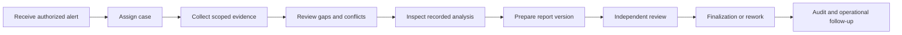

# Phase 1: business scope and acceptance baseline

**Document status:** draft for review, 19 November 2026.  
**Product:** FinAgent Enterprise, human-reviewed AML investigation copilot.  
**Evidence boundary:** synthetic development and demonstration; this document is not an institutional business requirements approval, legal interpretation, service-level commitment or production authorization.

## 1. Purpose and problem

An analyst may need to reconcile alert data, customer and transaction records, documents, policy, previous investigation output and review decisions. Inconsistent, missing, stale or conflicting sources can make an investigation difficult to reproduce. AI assistance introduces additional requirements for source context, controlled access, validation and human judgment.

The project's intended outcome is an investigation workflow where authorized people can inspect evidence and its limitations, prepare a traceable draft and route a version to independent review. Improvement in handling time, detection quality, staffing cost or regulatory outcomes has not been measured and must not be claimed as achieved.

## 2. Objectives and non-goals

| Objective | Proposed indicator to agree | Current status |
|---|---|---|
| Traceable investigation | Proportion of sampled material claims with inspectable source context | Definition, baseline and target open |
| Human accountability | Review decisions tied to authorized people and a specific report/evidence context | Implementation and tests exist for selected workflows; institution must approve policy |
| Appropriate access | Authorized users can work on their assigned scope; unauthorized attempts are denied | Negative checks exist; full institutional matrix and independent assessment open |
| Visible uncertainty | Users can distinguish absent, stale, blocked, unavailable and historical information | UI work in progress; full acceptance open |
| Recoverable operations | Failures and ambiguous external outcomes are visible and can be reconciled | Engineering design exists; operational targets and target-environment exercises open |

The platform does not autonomously decide guilt, file regulatory reports, transfer funds, or make account-freezing decisions as part of this scope. A narrowly guarded external case-status integration is described separately and remains subject to configuration, authorization and institutional approval.

## 3. Scope

**In the synthetic working scope:** alert/case workflow; authorized evidence and transaction review; document upload and provenance; controlled investigation outputs; versioned drafts and independent review; audit and workflow history; selected administration, operational and evaluation functions; and local mock integrations. Some workspace views are illustrative or read-only and must be labeled accordingly.

**Outside current demonstrated scope:** verified live banking or cloud deployment; processing real customer data; independent certification; guaranteed detection accuracy or cost reduction; full production accessibility and operational acceptance; and institution-specific regulatory approval.

**Conditional future scope:** live providers, enterprise identity, approved data sources, deployment, legal/privacy controls and a production operating model. Each requires named owners, agreements, test evidence and explicit release authorization.

## 4. Stakeholders and responsibilities

| Stakeholder | Intended interest | Decision or contribution to confirm |
|---|---|---|
| Business sponsor / product owner | Scope, outcomes and investment | Pilot boundaries and acceptance |
| Analyst | Evidence review and draft preparation | Investigation quality and escalation |
| Independent reviewer | Review of submitted context | Decision authority and separation of duties |
| AML supervisor | Workload and exception oversight | Assignment, escalation and rework policy |
| Data and source owners | Source quality and access | Contracts, freshness and permissible data use |
| Security and privacy leads | Access, protection and data handling | Threat/risk review and control acceptance |
| Model risk and domain leads | AI output and evaluation | Evaluation criteria, monitoring and promotion |
| Engineering and operations | Delivery and reliable service | Architecture, deployment, support and recovery evidence |
| Legal / compliance | Jurisdiction and obligations | Institution-specific applicability and approval |

These are role placeholders. No named owner or institutional sign-off is implied. See the [open decision register](../decisions/open-decisions.md).

## 5. End-to-end value stream

Each transition depends on permitted role, actual case state and available services. Missing evidence can interrupt the path; a recorded finding or completed status does not by itself prove the current source data is complete or correct.

## 6. Draft acceptance scenarios

These are proposed review criteria, not claims that every scenario has been accepted. Existing [provisional use cases](../requirements/provisional-use-cases.md) remain the authoritative local scenario index until the formal use-case document and institutional criteria are agreed.

| Scenario | Draft observable outcome | Existing reference | Acceptance status |
|---|---|---|---|
| Authorized investigation | Assigned analyst opens a permitted case, inspects source context and prepares a draft | PUC-01; [acceptance journey](../testing/acceptance-journey.md) | Formal owner/UAT pending |
| Missing evidence | Missing or unavailable evidence is visible and does not silently become a clean result | PUC-03 | Formal owner/UAT pending |
| Conflicting sources | Both records and an authorized, reasoned resolution are retained | PUC-04 | Formal owner/UAT pending |
| Access isolation | Unauthorized tenant, role or case access is rejected by the service | PUC-05; [access control](../security/access-control.md) | Independent target-environment review pending |
| Independent review | A decision is bound to the version/context reviewed; prohibited self-approval and stale approvals are rejected | PUC-06, PUC-07 | Institutional reviewer matrix and acceptance pending |
| Unsafe or unsupported output | Boundary violations, unsupported evidence or invalid output are handled by defined controls | PUC-09 | Independent AI evaluation and target-model assessment pending |
| Interrupted or uncertain work | A failure is visible and recovery avoids unverified repeated external effects | PUC-08, PUC-19 | Target-environment recovery exercise pending |
| Accessible UI | Key journeys work on agreed devices with keyboard and assistive technology, including error and session states | PUC-13; [UI tracker](../production-ui-work-tracker.md) | Devices, criteria and complete accessibility review pending |

Detailed acceptance must specify test data, role, preconditions, observable result, ownership, environment, evidence and severity. Test results must be associated with an exact commit; scenario descriptions are not test results.

## 7. Dependencies and open decisions

The project depends on an approved alert family, source systems and contracts, data classification and residency, role and reviewer matrix, identity provider, policy ownership, AI provider and evaluation, supported languages, service objectives, retention, incident response, and release authority. These remain open or local defaults in the [decision register](../decisions/open-decisions.md) and [source register](../data/source-register.md).

## 8. Review and exit criteria

The documentation phase is **drafted**, not formally complete. To approve this baseline, appoint a product owner, AML lead, reviewer representative, data owner, security/privacy lead and operations lead; review scope and non-goals; agree measurable objectives and scenario criteria; record decisions, versions and unresolved risks; and link the approval record. Subsequent phases must keep these decisions synchronized with architecture, engineering and evidence.
