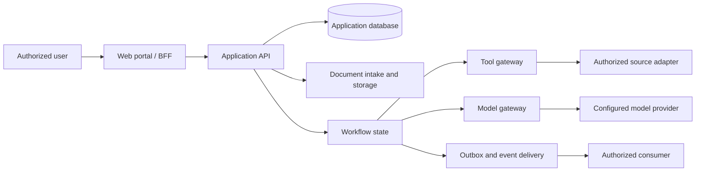

# Integration and interface design

**Status:** source-based engineering baseline, 19 November 2026. API and event definitions are repository contracts, not agreements with a bank or proof that an external provider is live. Confirm behavior against the exact source revision and generated [OpenAPI specification](../api/openapi.json).

## Integration landscape

Logical boundaries are shown; this is not a production network diagram. Local source and model behavior are synthetic. The [source register](../data/source-register.md) lists proposed source ownership and field expectations.

## Interface inventory

| Interface | Consumer / producer | Purpose and key contract | Verification boundary |
|---|---|---|---|
| Web to application API | Web BFF → API | Authenticated server-side requests; application authorizes principal, tenant, case and operation | Test local and chosen identity/session flows separately; do not infer live provider acceptance |
| Case evidence | Web or authorized client → API | Case-scoped evidence, documents, snapshots and conflict resolution | Check authorization, tenant/case isolation, stale/missing data and errors |
| Evidence search | Authorized client → API | Case-scoped search over current evidence; links point back to source records | Literal search has limitations and is not a risk decision or model answer |
| Source connectors | Tool gateway → configured source | Typed source projections and bounded subject/window scope | Mock-bank tests do not establish a live bank contract |
| Document intake | Authorized client → document service | Versioned upload, scanning interface, quarantine and extraction | Local scanner and parser tests do not establish production scanner efficacy |
| Model access | Workflow → model gateway → provider | Capability-specific context, budget controls, recorded usage and validated outputs | Synthetic model behavior does not establish live model quality |
| Events | Outbox relay → consumer | Versioned signed envelope and references; documented at-least-once delivery | Validate signatures, duplicate handling and recovery with the actual deployment |
| External case-status write | Guarded finalization → source adapter | Narrow write path subject to policy, settings, tenant flag and effect ledger | Disabled by default in local configuration; actual target and reconciliation agreement remain open |

Selected current routes include `GET /api/v1/cases/{case_id}/evidence`, `POST /api/v1/cases/{case_id}/evidence-search`, `GET` and `POST /api/v1/cases/{case_id}/snapshots`, and `GET /api/v1/cases/{case_id}/documents`. Consult the generated specification and source for request shapes, role requirements and error behavior; this table does not replace the contract.

## Source data and compatibility

Source responses are projected into typed models. The connector decision records schema-version and time requirements, identifier validation, allowed destinations, retry classification and transaction-window completeness rules. Currency amounts and dates must retain their meaning; a filtered transaction total is not an account balance. Source systems, versions, timestamps, freshness and incomplete pages must be disclosed where available.

Before a real integration, agree on the named system and owner; versioned schema; field mapping; classification; tenant and subject mapping; authentication and authorization; rate limits; ordering and pagination; freshness; correction, revocation and deletion signals; and incident contacts. Changes require compatibility review, test fixtures, owner approval and a rollout/rollback plan.

## Failure, retry and side effects

- Treat authorization, validation, revocation and schema failures distinctly from retryable source outages. Do not repeatedly retry an unauthorized request.
- For event delivery, the design documents at-least-once delivery, signed envelopes, consumer deduplication and dead-letter handling; see [event contracts](../api/events.md).
- For guarded external effects, record intent and use idempotency/probing. An outcome that cannot be established is handled as uncertain and requires reconciliation; the design does not claim exactly-once execution. See [ADR-0015](../adr/0015-durable-workflow-runtime.md).
- Retain correlation, source version and audit references without exposing secrets or unnecessary customer content in logs.

## Interface acceptance checklist

For each live integration, record the authorized owner and environment; approved contract version; field and classification mapping; identity and privilege scope; negative and cross-tenant tests; handling of pagination, duplicates, timeouts, revocation and stale data; audit and monitoring; idempotency and recovery behavior; measured capacity; and sign-off evidence. None of these are established merely by the presence of a mock or adapter.

## Related decisions

[Typed connectors and tool gateway](../adr/0016-connectors-and-tool-gateway.md) · [Workflow runtime and effect ledger](../adr/0015-durable-workflow-runtime.md) · [Evidence and snapshots](../adr/0017-documents-evidence-and-snapshots.md) · [Investigation and review gate](../adr/0020-investigation-graph-review-and-finalization.md) · [Architecture-to-code map](06-ARCHITECTURE-TO-CODE-MAP.md)
