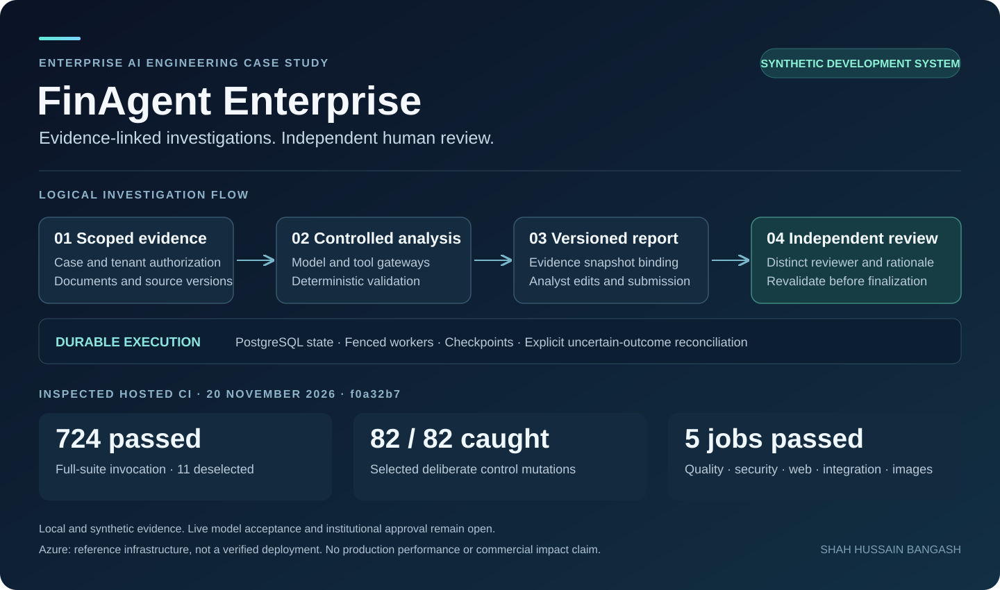
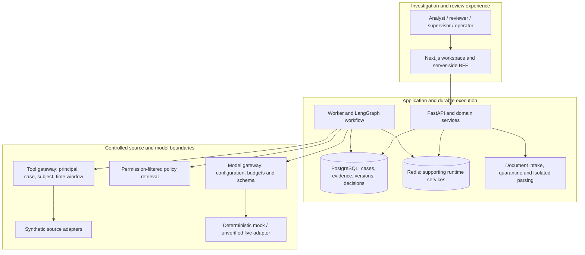
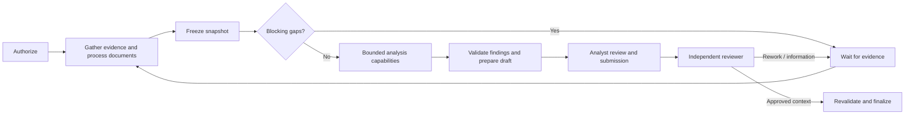
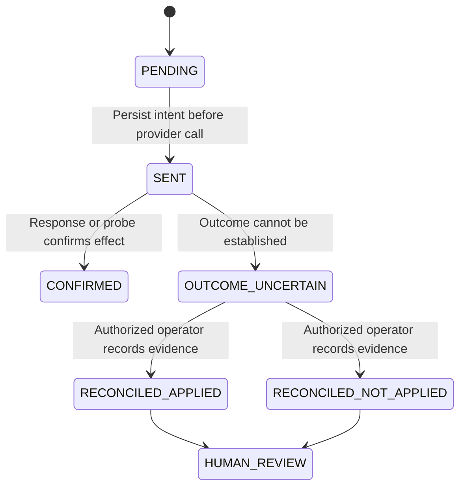

# FinAgent Enterprise Case Study

## Architecting evidence-linked AI investigations with independent human review

**Enterprise solution architecture · Generative AI · Agent orchestration · Security and governance · Cloud reference design · Software engineering · Evaluation research**

| Project | At a glance |
|---|---|
| Project owner | Shah Hussain Bangash · [GitHub](https://github.com/shah-hussain-bangash) |
| Domain | Anti-money laundering investigation and case review |
| Delivery scope | Independent engineering project using synthetic identities, data and integrations |
| Application | Next.js / React / TypeScript, FastAPI / Python, PostgreSQL, Redis and LangGraph |
| Source baseline | [`f0a32b7`, main, 20 November 2026][baseline] |
| Directly inspected hosted evidence | [CI run 44723085210][ci]: five successful jobs; 724 passed and 11 deselected in the full-suite invocation; 82/82 defined mutations caught |
| Later investigation evidence | [CI run #77](https://github.com/shah-hussain-bangash/finagent-enterprise/actions/runs/45394113664), branch commit [`a6c157b`](https://github.com/shah-hussain-bangash/finagent-enterprise/commit/a6c157b8d059fdc1ac93cbaa3d158050395c7ebf): seven successful jobs and 17 synthetic browser scenarios |
| Current maturity | Implemented synthetic workflow; cloud deployment, live-provider acceptance and institutional approval remain open |

**The architectural contribution:** FinAgent connects evidence gathering, bounded AI capabilities, deterministic financial checks, versioned reports and independent review within a recoverable workflow. Its most useful demonstration is the control path from an authorized case to a reviewed decision—and the behavior when evidence, permissions or external outcomes change.

[Business challenge](#1-business-challenge-and-objectives) · [Architecture](#3-solution-architecture) · [AI design](#4-generative-ai-and-agentic-architecture) · [Security](#6-security-and-governance) · [Engineering evidence](#8-results-and-verification) · [Walkthrough](#10-technical-walkthrough)

## 1. Business challenge and objectives

An AML analyst may need to reconcile an alert with customer records, transactions, document versions, policy and previous decisions. These sources can be incomplete, inconsistent or stale. A fluent AI summary adds little value if an investigator cannot identify its source, reproduce its calculation or determine whether the reviewer saw the same evidence.

FinAgent frames the problem as an investigation and accountability workflow. The analyst needs a connected evidence workspace; the reviewer needs the exact submitted report and evidence context; the operator needs visible failure states and recovery controls.

The project translates those needs into five engineering objectives:

| Objective | Architectural response | Outcome to measure in a future pilot |
|---|---|---|
| Make material claims inspectable | Evidence references, document versions, snapshots and calculation records | Supported-claim rate and time to verify a sampled claim |
| Preserve accountable decisions | Distinct analyst/reviewer roles and version-bound decisions | Self-review rejection, stale-decision rejection and reviewer agreement |
| Limit sensitive access | Tenant, case, role, subject and tool constraints | Denied-access results across the approved institutional matrix |
| Make uncertainty visible | Gaps, conflicting guidance, partial outputs and uncertain-operation states | Correct escalation and unsupported-answer abstention |
| Recover without silently repeating effects | Durable state, fenced workers, idempotency and reconciliation | Recovery time and observed duplicate effects under specified faults |

These are measurement objectives. Analyst productivity, fraud-detection improvement, false-positive reduction and financial savings have not been established. The [business scope][business] defines the synthetic boundaries and open acceptance decisions.

### A representative investigation

An assigned analyst opens a synthetic transaction-monitoring case, examines transactions and document provenance, and inspects calculation-backed findings. Missing evidence or conflicting policy can interrupt the workflow. The analyst reviews a draft, edits it and submits a specific version. An eligible independent reviewer inspects the report and snapshot, supplies a rationale, and records a decision. Finalization rechecks the relevant authority and context.

The system does not confer authority to determine guilt, move funds, freeze accounts or file regulatory reports. A narrowly guarded external case-status integration is a separate capability with explicit deployment and tenant controls.

The hosted browser journey demonstrates one such synthetic case: the analyst recovers an accepted update after a simulated gateway error, resolves conflicting evidence and submits report version 2. A different reviewer approves the recorded version and snapshot; the test checks its evidence references and observes case completion. A supervisor then reopens the case, leaving the test in rework. Separate scenarios verify recovery after a report withdrawal or workflow cancellation receives a gateway error. See the [acceptance record](../05-testing-evidence/14-SYNTHETIC-ACCEPTANCE-RECORD.md) for the tested revision, reproduction and limits. These results do not establish live-provider behavior or production acceptance.

## 2. Engineering scope and contribution

FinAgent's repository provides a connected set of architecture decisions, application source, contracts, migrations, tests and operating guides. These make the following contribution areas reviewable:

| Discipline | Concrete material to examine |
|---|---|
| Enterprise solution architecture | Business capability model, trust boundaries, source contracts and [architecture-to-code map][code-map] |
| Generative AI architecture | Capability registry, minimized context, [model gateway][gateway] and [output validation][validator] |
| Agentic architecture | [AML graph][graph], durable checkpoints, bounded execution and human interrupts |
| Security and governance | Authorization policy, independent review, database privilege separation and configuration promotion |
| Cloud and infrastructure | Azure Terraform and Helm reference assets, plus local container builds |
| Software engineering | Typed APIs, generated contract checks, migrations, behavioral tests and mutation checks |
| Applied evaluation research | Dataset lineage, contamination controls, promotion gates and explicit limits on conclusions |

The repository is engineering evidence. It does not establish an employment title, years of experience, a managed delivery team or institutional ownership. The project owner should describe personal responsibilities and any tooling assistance accurately when discussing the work.

## 3. Solution architecture

*Logical responsibility view of the inspected source. It does not represent a verified production network.*

The web backend-for-frontend keeps backend access behind the server-side application boundary. FastAPI services own business operations and authorization. PostgreSQL records the durable investigation state. The worker executes the graph, with source and model access passing through separate gateways.

Document processing has its own boundary because an uploaded file is untrusted input. Policy retrieval has lifecycle and access conditions because a relevant-looking passage may be unauthorized, revoked or ineffective for the investigation date.

### Decisions and alternatives

| Decision | Alternative considered in this case analysis | Reason and consequence |
|---|---|---|
| LangGraph owns orchestration | Competing workflow owners in multiple frameworks | One workflow owner makes state and resume behavior easier to trace; graph-version compatibility remains an operating concern |
| Database-backed run state with fenced leases | Treat the queue as the authoritative work record | A lost notification need not erase a run; correctness requires careful transactional and lease handling |
| Deterministic orchestration controls tool access | Let each model capability discover and invoke arbitrary tools | Keeps authority outside model text; requires explicit connector and capability contracts |
| Deterministic calculations and evidence-bound validation | Accept financial numbers from generated prose | Makes selected numerical claims checkable; cannot establish the truth of every interpretation |
| Version-bound independent review | Approve only a case identifier or mutable report | Records what was actually reviewed; material changes can require renewed review |
| Local retrieval behind an adapter | Require cloud retrieval for every development run | Enables repeatable local work; local results do not validate the Azure retrieval configuration |

The alternatives above are architectural analysis, not a claim that every option underwent a measured experiment. The repository's [ADRs][adrs] record the actual engineering decisions.

## 4. Generative AI and agentic architecture

### Separate model capability from decision authority

FinAgent implements a graph of constrained capabilities for KYC, AML, document and compliance analysis, followed by report preparation. The [graph source][graph] gathers evidence, processes documents, freezes a snapshot, runs analysis, prepares a draft and waits for review. Evidence gaps can interrupt the graph; deterministic services supply permitted resume decisions.

This is governed orchestration of model capabilities. It does not demonstrate unrestricted autonomous agents or open-ended multi-agent negotiation. Runtime MCP/A2A discovery is deliberately excluded from Release 1 under [ADR-0010][protocol].

### Centralize inference controls

The [model gateway][gateway] checks capability enablement and configured call, token and cost limits. It applies timeouts, classified transient retries and at most one schema-repair attempt. Usage records retain attempt status, counts, cost estimates and configuration/prompt identifiers; the gateway avoids storing raw prompt and output bodies in its usage logging path.

The architecture minimizes facts supplied to individual capabilities. For example, the AML preparation contract excludes name, date of birth and nationality from that capability's context. This is a concrete data-minimization choice, rather than relying entirely on prompt instructions.

Budget checks support spend governance, but the code is not evidence of a strictly reserved, concurrency-safe billing ceiling across a large deployment. A production assessment must examine concurrent admission, provider metering and reconciliation.

### Ground retrieval before generation

The [policy lifecycle and retrieval decision][retrieval] filters approved/indexed versions by tenant, effective date, allowed roles and applicability before ranking. The local implementation uses deterministic retrieval; Azure AI Search is a separate adapter whose live operation is unverified.

Citations include policy version, section, page, chunk and text hash. Validation rechecks access and provenance. Conflicting effective versions can produce a conflict state; insufficient evidence leads to abstention. Lexical support and matching references provide mechanical checks, not semantic proof.

### Validate generated output as a proposal

The [validator][validator] checks evidence references, numerical membership in cited sources, exact deterministic-result values and selected prohibited authority claims. Invalid findings can be rejected and a nominally successful output downgraded. The report validator restricts narrative sections to accepted upstream claims or trusted context.

These checks give engineers inspectable failure conditions. Regular-expression authority checks do not cover every paraphrase or language; a number appearing in a source does not prove the surrounding statement. Representative live-model evaluation and human review remain essential.

OWASP's [prompt-injection guidance][owasp] supports least privilege, deterministic output handling and approval for sensitive actions, while explicitly recognizing that RAG does not remove injection risk. This comparison explains the design rationale; it is not an OWASP certification.

**Provider status:** the inspected release uses a deterministic mock for repeatable tests. An Azure OpenAI adapter exists, but live acceptance is unverified. The separate experimental assistant candidate remains disabled. Synthetic tests cannot supply a real-model accuracy claim.

## 5. Reliability and independent review

### Make approval depend on the reviewed context

The [review service][review] binds a submission to its report version and evidence snapshot. An approval decision requires the assigned reviewer or an explicitly permitted delegate, step-up authentication and a rationale. It rejects the submitter, report authors and assigned analyst as conflicting reviewers, including relevant delegation paths. Superseded context and detected evidence drift invalidate the decision path.

This addresses a practical race: a reviewer opens report version A, the analyst changes the evidence, and the reviewer later approves the old screen. Binding the decision to immutable identifiers and checking current state makes that race explicit. The finalization service performs its own checks rather than treating the presence of any approval row as sufficient authority.

### Recover a worker without trusting stale ownership

The [durable-runtime ADR][durability] records database-backed runs, monotonic fencing tokens, encrypted checkpoints, completed-step references and outbox/inbox processing. Protected commits verify the current lease. Resume processing checks graph compatibility and the requester's current rights.

The trade-off is additional state and transactional complexity. Recovery must preserve authorization as well as execution continuity: a requester who has lost permission should not retain it through an old queued run.

### Treat an uncertain external result as a distinct state

An external service can accept a request and then time out before returning a response. Retrying immediately can repeat the effect. The [external-operation ledger][effects] persists intent before calling the provider, supplies an idempotency key, and probes an earlier unconfirmed attempt. An outcome it cannot establish becomes `OUTCOME_UNCERTAIN`.

*Simplified uncertain-outcome path. Definite rejection and other runtime transitions are omitted for readability.*

Reconciliation records a reason and returns the run to human review. The design depends on provider behavior and observable evidence; it does not establish exactly-once execution across arbitrary external systems.

## 6. Security and governance

| Threat or failure | Implemented mechanism to inspect | Residual concern |
|---|---|---|
| Cross-tenant or unassigned-case access | Tenant filters, role checks and active case assignments | Verify every API, export, background job and deployment identity |
| Administrative access becoming case-content access | Administrative roles have no default case-content permission | Institution must approve the complete matrix and emergency-access process |
| Model-requested expansion of authority | Tool registry, capability allowlists, subject/time-window/data-class constraints | Live connector credentials and upstream authorization need separate validation |
| Untrusted or malicious document | Actual-byte limits, signature checks, quarantine and isolated parsing | Local scan fixtures are not antivirus; target scanner and isolation need operational tests |
| Self-approval or stale review | Reviewer separation, step-up and exact report/snapshot binding | Independent institutional policy and role-based UAT remain open |
| Audit modification by application credentials | Restricted application grants and append-only database controls | These controls do not establish independent tamper-proof external retention |
| Unsafe model configuration promotion | Same-configuration evaluation evidence and release-dataset gates | Independent validation/release datasets and approved thresholds are absent |

The [access-control summary][access] connects identity, step-up, delegation, emergency access and database privileges. Migration ownership is separated from the runtime application role, reducing the authority available to normal application processes.

### Governance for a UAE financial-services context

The project includes a [regulatory applicability register][regulatory] for institution-specific review. Its rows remain pending. A real deployment must establish the applicable entity, jurisdiction, data flows, source permissions, retention, residency, decision rights and control owners before enabling live data.

NIST's [AI RMF Playbook][nist] provides a useful organizing lens: govern ownership and decision rights; map intended use and affected users; measure model and control behavior; manage release decisions and incidents. Applying this lens here is an analytical mapping, not a completed assessment or regulatory approval.

## 7. Cloud, infrastructure and operating model

The implemented delivery path includes local Compose services and hosted builds of API, worker and web container images. Azure infrastructure is a reference design.

The [Terraform source][terraform] describes PostgreSQL Flexible Server, Key Vault, Blob Storage, Service Bus, AI Search, Container Registry, Log Analytics and workload identities. The [Helm assets][helm] describe application workloads, a dedicated migration job, probes, resource configuration and network-policy elements. These templates have not been applied or validated as a working Azure deployment. Private endpoints, DNS, complete traffic allowances, service availability, identity wiring and regional choices need end-to-end validation.

| Operating concern | Existing foundation | Required next evidence |
|---|---|---|
| Delivery | CI and three container builds | Immutable image digests, registry publishing, signing, SBOM and approved promotion |
| Identity and secrets | Local identity controls and cloud identity/secret references | Verified target IdP, managed identities, rotation and recovery |
| Availability and scale | Durable runtime and reference replica/resource settings | Workload model, load tests, failure-domain review and measured SLOs |
| Recovery | Runbooks and tested synthetic runtime recovery paths | Environment-specific backup restoration, rollback and measured RTO/RPO |
| Cost | Per-attempt model usage and budget checks | Provider prices, concurrency model and infrastructure cost measurements |

A useful cost model is:

`cost per completed case = (model + parsing/retrieval + allocated infrastructure + human review/rework cost) / completed cases`

Inputs must come from measured workloads. No monthly cloud bill, availability percentage, p95 latency or recovery objective has been established by the reference assets. See the [deployment guide][deployment].

## 8. Results and verification

The original source baseline for the detailed results below is [`f0a32b7908d766a2e4c9fb7b9c97906c27ab3c9a`][baseline]. Its [20 November 2026 hosted run][ci] completed all five jobs successfully. The integration log was inspected directly for the counts below; later browser evidence is identified separately.

| Evidence | Recorded result | Interpretation |
|---|---|---|
| Quality | Successful job | Python lint/types, unit invocation and API/event contract drift checks completed |
| Security | Successful job | Repository security task and secret-scan step completed |
| Web | Successful job | Dependency install, production-dependency audit, type check and optimized build completed |
| Release-blocker invocation | 343 passed; 392 deselected | The selected blocker tests passed; deselected tests were not run in that invocation |
| Full-suite invocation | 724 passed; 11 deselected | The configured suite passed; it did not execute the deselected browser set |
| Selected control mutations | 82/82 caught | Selected tests detected every defined deliberate mutation |
| Images | Successful job | API, worker and web images built; the job did not push, sign or deploy them |

The blocker and full-suite counts overlap and must not be added. Mutation-test failures are expected responses to deliberately modified code, rather than ordinary application failures.

### Three controls with directly traceable evidence

| Control | Source | Observed mutation outcome in this run |
|---|---|---|
| Tenant-scoped case reads | Case-query filter identified by `tenant-filter` in [mutation definitions][mutations] | Removing the filter was caught |
| Independent reviewer | [Review service][review]; `review-separation-of-duties` | Bypassing the conflict guard was caught |
| Uncertain effects are not blindly resent | [External-operation ledger][effects]; `ambiguous-not-resent` | Changing the uncertainty-handling path was caught |

This demonstrates sensitivity of selected tests to selected defects. It does not measure complete security coverage, incident rates or live-bank reliability.

### Browser evidence has a separate boundary

The [earlier acceptance record][acceptance] reports a local browser journey passing after a dependency patch on 20 November 2026: one test passed in 42.10 seconds, with specified source files matched by hash. The original baseline's full-suite invocation deselected browser tests. A later, separate hosted browser job passed 17 synthetic scenarios in [run #77](https://github.com/shah-hussain-bangash/finagent-enterprise/actions/runs/45394113664) at `a6c157b`; see the [current acceptance record](../05-testing-evidence/14-SYNTHETIC-ACCEPTANCE-RECORD.md) for its scope and limitations.

The practical outcome is a reviewable application and a substantial regression/evidence base. Commercial impact and production acceptance remain to be measured.

## 9. Research method and next experiments

The most credible research contribution at this stage is evaluation governance. The [dataset controller][dataset-code] and [dataset guidance][datasets] register canonical hashes, scenario lineage, split purpose and contamination history. They reject exact-input reuse across splits even when identifiers or labels change. Locked release datasets cannot be silently rewritten under the same name.

`aml-synthetic-v1` has already been used for development. It must remain development data. Independent validation and locked release collections are not supplied, and development evaluations cannot authorize release promotion. Exact-input checks also cannot establish the absence of semantic near duplicates.

The next study should test a precise question: **does the combination of scoped retrieval and deterministic validation improve supported findings and abstention on genuinely unseen investigations, at an acceptable review cost?**

| Experiment | Design | Measures |
|---|---|---|
| Grounding and abstention | Compare approved configurations on separately reviewed unseen scenario families | Claim support, citation correctness, unsupported-answer and abstention rates |
| Retrieval quality | Compare lexical baseline and approved cloud retrieval with the same authorized corpus | Recall@k, ranking relevance, effective-date errors and unauthorized retrieval |
| Validator trade-off | Offline ablation of selected checks using adversarial synthetic outputs | Invalid-claim acceptance, valid-claim rejection and reviewer rework |
| Operational resilience | Kill a worker, expire a lease, revoke access and simulate delayed provider responses | Recovery time, stale-commit rejection and observed effect count |
| Human usefulness | Paired cases with blinded, independent reviewers | Handling time, evidence-verification time, quality rubric and agreement |

Freeze datasets, configurations and scoring rules before evaluation; report denominators, uncertainty intervals, language slices and error examples. Choose acceptance thresholds with AML and model-risk owners. These are proposed experiments, not completed results or a claim of novel model research.

## 10. Technical walkthrough

A focused ten-minute demonstration can make the architecture concrete:

1. **Problem and scope — one minute:** explain the synthetic alert, analyst responsibility and independent reviewer.
2. **Evidence — two minutes:** open a case, inspect transactions and document versions, follow a source reference, and show a missing or conflicting record.
3. **AI boundary — two minutes:** trace a capability through minimized context, the gateway, deterministic calculation and validation. State the actual provider in use.
4. **Review — two minutes:** submit a report version, switch to an independent identity, and demonstrate prohibited self-review or stale-context rejection using a prepared synthetic fixture.
5. **Recovery — two minutes:** inspect a recorded uncertain operation and explain why reconciliation precedes further action.
6. **Engineering evidence — one minute:** open the pinned CI run and one source-to-test trace, then explain the next acceptance gate.

Use the [workspace walkthrough][walkthrough] for navigation and [API acceptance test][api-journey] for executable behavior. Run demonstrations only in a dedicated synthetic environment; the fixtures can reset their configured test database. Preview role selectors and fixed assistant responses are illustrative and do not change actual authority or invoke a live assistant.

### Interview discussion prompts

- Why is evidence snapshotting useful when current source data can change?
- What does a valid citation prove, and what does it leave unresolved?
- How do fenced leases differ from merely marking a run as running?
- What happens if a provider commits an operation and the response is lost?
- Why should model promotion require unseen, locked evaluation data?
- What evidence would justify moving from a local prototype to an approved cloud pilot?

## 11. Next delivery gates

| Priority | Gate | Completion evidence |
|---|---|---|
| 1 | Reproducible current browser/API demonstration | Exact commit/build, isolated environment, role-specific outcomes, audit and fault-recovery artifacts |
| 2 | Independent AI evaluation | Reviewed validation/release datasets, locked configuration, measured results and approved criteria |
| 3 | Synthetic cloud staging | Validated infrastructure, identity/secret/network checks, image digest, smoke tests and cost record |
| 4 | Operational and security assessment | Threat-model review, negative tests, accessibility/load results and restoration/rollback exercise |
| 5 | Institution-specific pilot decision | Named business, data, security, AML, model-risk and operations owners with approved scope |

FinAgent's strongest engineering evidence is the connection between architecture and executable controls: source-bound analysis, independent version-aware review and recoverable workflow execution. The next step is to extend that evidence into representative model evaluation and an approved operating environment.

---

**Evidence dates:** The detailed source baseline below was inspected on 21 November 2026. The later hosted investigation result is explicitly identified by revision and run above. Repository documents with historical local results retain their original scope.

[baseline]: https://github.com/shah-hussain-bangash/finagent-enterprise/commit/f0a32b7908d766a2e4c9fb7b9c97906c27ab3c9a
[ci]: https://github.com/shah-hussain-bangash/finagent-enterprise/actions/runs/44723085210
[business]: https://github.com/shah-hussain-bangash/finagent-enterprise/blob/f0a32b7908d766a2e4c9fb7b9c97906c27ab3c9a/docs/01-business-requirements/01-BUSINESS-SCOPE-AND-ACCEPTANCE.md
[code-map]: https://github.com/shah-hussain-bangash/finagent-enterprise/blob/f0a32b7908d766a2e4c9fb7b9c97906c27ab3c9a/docs/02-system-architecture/06-ARCHITECTURE-TO-CODE-MAP.md
[adrs]: https://github.com/shah-hussain-bangash/finagent-enterprise/tree/f0a32b7908d766a2e4c9fb7b9c97906c27ab3c9a/docs/adr
[gateway]: https://github.com/shah-hussain-bangash/finagent-enterprise/blob/f0a32b7908d766a2e4c9fb7b9c97906c27ab3c9a/src/finagent/agents/gateway.py
[validator]: https://github.com/shah-hussain-bangash/finagent-enterprise/blob/f0a32b7908d766a2e4c9fb7b9c97906c27ab3c9a/src/finagent/agents/validation.py
[graph]: https://github.com/shah-hussain-bangash/finagent-enterprise/blob/f0a32b7908d766a2e4c9fb7b9c97906c27ab3c9a/src/finagent/orchestration/graphs/aml.py
[protocol]: https://github.com/shah-hussain-bangash/finagent-enterprise/blob/f0a32b7908d766a2e4c9fb7b9c97906c27ab3c9a/docs/adr/0010-no-runtime-mcp-a2a-in-release-1.md
[retrieval]: https://github.com/shah-hussain-bangash/finagent-enterprise/blob/f0a32b7908d766a2e4c9fb7b9c97906c27ab3c9a/docs/adr/0018-policy-retrieval.md
[review]: https://github.com/shah-hussain-bangash/finagent-enterprise/blob/f0a32b7908d766a2e4c9fb7b9c97906c27ab3c9a/src/finagent/services/review_service/review.py
[durability]: https://github.com/shah-hussain-bangash/finagent-enterprise/blob/f0a32b7908d766a2e4c9fb7b9c97906c27ab3c9a/docs/adr/0015-durable-workflow-runtime.md
[effects]: https://github.com/shah-hussain-bangash/finagent-enterprise/blob/f0a32b7908d766a2e4c9fb7b9c97906c27ab3c9a/src/finagent/services/workflow_service/external_ops.py
[access]: https://github.com/shah-hussain-bangash/finagent-enterprise/blob/f0a32b7908d766a2e4c9fb7b9c97906c27ab3c9a/docs/security/access-control.md
[regulatory]: https://github.com/shah-hussain-bangash/finagent-enterprise/blob/f0a32b7908d766a2e4c9fb7b9c97906c27ab3c9a/docs/security/regulatory-applicability-register.md
[terraform]: https://github.com/shah-hussain-bangash/finagent-enterprise/blob/f0a32b7908d766a2e4c9fb7b9c97906c27ab3c9a/infra/terraform/main.tf
[helm]: https://github.com/shah-hussain-bangash/finagent-enterprise/tree/f0a32b7908d766a2e4c9fb7b9c97906c27ab3c9a/infra/helm
[deployment]: https://github.com/shah-hussain-bangash/finagent-enterprise/blob/f0a32b7908d766a2e4c9fb7b9c97906c27ab3c9a/docs/operations/deployment.md
[mutations]: https://github.com/shah-hussain-bangash/finagent-enterprise/blob/f0a32b7908d766a2e4c9fb7b9c97906c27ab3c9a/tests/mutations.yaml
[acceptance]: https://github.com/shah-hussain-bangash/finagent-enterprise/blob/f0a32b7908d766a2e4c9fb7b9c97906c27ab3c9a/docs/05-testing-evidence/14-SYNTHETIC-ACCEPTANCE-RECORD.md
[dataset-code]: https://github.com/shah-hussain-bangash/finagent-enterprise/blob/f0a32b7908d766a2e4c9fb7b9c97906c27ab3c9a/src/finagent/evaluation/dataset_control.py
[datasets]: https://github.com/shah-hussain-bangash/finagent-enterprise/blob/f0a32b7908d766a2e4c9fb7b9c97906c27ab3c9a/docs/testing/evaluation-datasets.md
[walkthrough]: https://github.com/shah-hussain-bangash/finagent-enterprise/blob/f0a32b7908d766a2e4c9fb7b9c97906c27ab3c9a/docs/workspace-demo-walkthrough.md
[api-journey]: https://github.com/shah-hussain-bangash/finagent-enterprise/blob/f0a32b7908d766a2e4c9fb7b9c97906c27ab3c9a/tests/e2e/test_acceptance_journey.py
[owasp]: https://genai.owasp.org/llmrisk/llm01-prompt-injection/
[nist]: https://www.nist.gov/itl/ai-risk-management-framework/nist-ai-rmf-playbook
