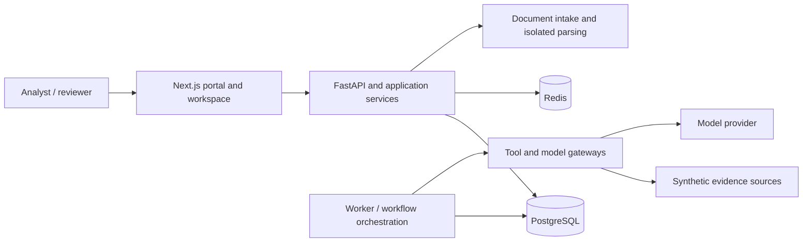

# FinAgent Enterprise: architecture portfolio brief

**Audience:** engineering leaders, enterprise architects, platform teams and technical interviewers.  
**Scope:** synthetic, human-reviewed AML investigation copilot; implementation and validation continue.  
**Repository:** [FinAgent Enterprise](https://github.com/zenithdevelopers7-source/finagent-enterprise). The latest workspace may be on an integration branch; check the selected branch and commit when reviewing.

## Executive context

Financial-crime investigations bring together alerts, customer records, transactions, documents, policy, and human decisions. A useful investigation platform must preserve the relationship between a claim and its evidence while limiting access by tenant, role and case. FinAgent explores this problem through a workflow that supports evidence gathering, analyst review, draft reporting and independent decision-making.

The system is a portfolio and engineering project using synthetic data. It should not be presented as a bank deployment, a certified compliance product, or an autonomous decision-maker. Existing local verification and GitHub checks are evidence for their specific commits and conditions, not evidence of a production launch.

## The architectural problem

The design balances five competing needs:

1. **Analyst productivity and human judgment:** provide connected views and draft assistance while preserving human responsibility for decisions.
2. **Useful AI and bounded trust:** retrieve relevant context and validate output without treating model text or uploaded documents as authoritative instructions.
3. **Connected data and isolation:** make case evidence available to authorized users while enforcing tenant, role and case boundaries.
4. **Automation and recoverability:** record execution and guard side effects so failures and uncertain outcomes can be investigated.
5. **Demonstrability and honesty:** make a synthetic workflow explorable while distinguishing illustrative screens, connected functions and unverified integrations.

## Architecture at a glance

This is a logical view of the source repository, not a production deployment diagram. See the [enterprise architecture](../02-system-architecture/03-ENTERPRISE-SOLUTION-ARCHITECTURE.md) for component responsibilities and trust boundaries, [deployment guidance](../operations/deployment.md) for reference infrastructure, and [decisions](../adr/) for documented rationale.

## Engineering decisions and trade-offs

| Decision | Rationale | Trade-off and remaining question |
|---|---|---|
| Human review and versioned reports | Preserve accountable decisions and trace the submitted report to recorded context | Adds review steps; the institution must approve the reviewer matrix and operational SLAs |
| Server-side authorization and case scope | Do not rely on client-side visibility to protect data | Requires consistent enforcement across every endpoint and source; independent assessment is pending |
| Evidence snapshots and provenance | Make recorded investigation context inspectable over time | Snapshots and current evidence can differ; users must see timestamps and limitations |
| Tool and model gateways with validation | Restrict access and inspect generated output | Validation does not prove factual truth; robust evaluation and source review remain necessary |
| Document quarantine and isolated parsing | Separate untrusted files from normal processing | Live scanning, isolation configuration and operational recovery still need target-environment testing |
| Explicit failure and uncertainty states | Avoid interpreting missing data or ambiguous effects as success | Requires operational ownership, escalation and tested recovery procedures |
| Synthetic demonstration | Supports safe, reproducible development without customer records | Cannot establish live-system performance, integration behavior or compliance |

## Evidence available for a technical discussion

The repository contains source, tests, ADRs, generated contracts, runbooks and a GitHub Actions workflow. On 19 November 2026, [CI run #7](https://github.com/zenithdevelopers7-source/finagent-enterprise/actions/runs/44469329182) passed quality, security, web, integration and image jobs for commit `7ccb3c6`. An earlier mutation job had failed because two test anchors were outdated; those definitions were updated before this run. Check the [pull request](https://github.com/zenithdevelopers7-source/finagent-enterprise/pull/3) and the exact commit for subsequent results. A successful synthetic CI run is not a production assessment.

Earlier focused web rendering tests and an optimized build passed. These do not establish complete UI accessibility or production performance. The [evidence plan](../05-testing-evidence/07-TESTING-AND-EVIDENCE-PLAN.md) sets out the additional records needed.

### Three concrete engineering traces

The following traces use the mutation definitions and logs from CI run #7 for commit `7ccb3c6`. A mutation test intentionally changes code and expects a test to fail; **caught** means the selected test detected that deliberate change. It is evidence about that specific scenario, not proof of complete security or correctness.

| Concern | Source and engineering decision | Evidence from the recorded run | What it does not establish |
|---|---|---|---|
| Tenant isolation | [Case queries](../../src/finagent/services/case_service/queries.py) include a tenant filter; [ADR-0006](../adr/0006-postgresql-composite-tenant-keys.md) records tenant-aware data design | `tenant-filter` in [mutation definitions](../../tests/mutations.yaml) was caught when the filter was deliberately removed | Complete isolation across every endpoint, dependency and live deployment |
| AI authority boundary | [Output validation](../../src/finagent/agents/validation.py) checks authority-boundary language; [ADR-0019](../adr/0019-model-gateway-and-deterministic-validation.md) describes the gateway and validation design | `validator-boundary` was caught when the check was deliberately bypassed | General prompt-injection resistance, model truthfulness or independent AI approval |
| Independent review | [Review service](../../src/finagent/services/review_service/review.py) checks conflicts of interest; [ADR-0020](../adr/0020-investigation-graph-review-and-finalization.md) records version-bound review | `review-separation-of-duties` was caught when its guard was deliberately disabled | An institution-approved reviewer matrix or all possible delegation scenarios |

The run also caught the `ambiguous-not-resent` mutation in the [external-operation service](../../src/finagent/services/workflow_service/external_ops.py). This demonstrates the selected recovery test detected a deliberately changed uncertainty-handling path; it does not prove live provider reconciliation.

## Suggested interview walkthrough

1. State the problem and the synthetic scope; identify the human analyst and independent reviewer.
2. Follow one case through the queue, evidence, document provenance, findings and report review. Show timestamps and limitations instead of implying a live ledger.
3. Explain one security boundary: tenant and case authorization, source access through a gateway, or quarantined document handling.
4. Explain one reliability trade-off: snapshots versus current data, or uncertain external outcomes and reconciliation.
5. Show a specific architecture decision and the tests associated with it; identify the exact commit and test environment.
6. Explain what is incomplete: live provider verification, independent AI evaluation, full accessibility and performance acceptance, institution-specific decisions and operational sign-off.

## Next steps toward a stronger portfolio

- Curate a concise demonstration with synthetic records and screenshots tied to the current build.
- Complete the analyst UI and document role-specific journeys, accessibility and failure states.
- Record a verified architecture-to-code-to-test trace for a few representative controls, then expand it systematically.
- Provide reproducible setup and a clear distinction between the default branch and the actively developed branch.
- Add independently reviewed performance, security, evaluation and recovery evidence as it becomes available; do not invent figures or claim approvals.
- Tailor a résumé and interview narrative to actual responsibilities and evidence. This project alone does not guarantee a job or a particular salary.
